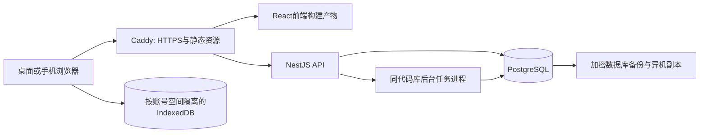

# AI 编程工作台 · 全栈全流程开发方案

> 版本：V2.0 规划基线｜日期：2026-11-03
> 已确认使用场景：个人或小团队私有部署。
> 输入依据：[原开发方案](AI编程工作台-开发方案.md)；原文件保留作为功能参考。
> 本文替代原方案中“单文件、零依赖、无后端、无账号、localStorage为主库”的技术约束。
> 当前交付的是开发方案与任务包，尚未创建应用、数据库或线上环境。原方案引用的设计方案尚未提供。

## 1. 建设目标

建设一套可登录、可跨设备访问、由服务端统一管理数据的 AI 编程工作台。保留“今日聚焦、项目雷达、知识库、AI 台账”四个业务模块，让任务、卡点、知识沉淀和效果记录形成闭环。

完整交付包括：前端应用、后端 API、数据库与迁移、账号与空间权限、旧数据迁移、自动化测试、容器部署、备份恢复、发布回退、监控告警、使用及运维文档。后端承担真实业务、事务和授权，不采用只有页面、没有持久化能力的接口占位版本。

第一版按 1～10 名成员、单台服务器、一个或少量工作空间规划。容量目标是每空间 1 万条知识、5 万条任务、5 万条台账；它们是验收测试数据规模，并非声称已经达到的能力或产品硬上限。

## 2. 与原方案的调整

| 原方案 | 全栈版执行方式 |
|---|---|
| 单个 index.html、零构建、无第三方包 | 前后端工程化，构建后部署；所有运行资源随应用发布，禁止依赖公共 CDN |
| 原生 JS + JSDoc | 前后端 TypeScript；共享接口类型，后端独立运行时校验 |
| localStorage 是业务主存储 | PostgreSQL 是唯一权威业务库；浏览器存主题、隔离缓存和未同步草稿 |
| 无后端、无账号 | NestJS API、登录会话、空间成员和权限 |
| 全量 loadAll + refreshAll | 分页 API、按资源缓存与失效、后端聚合统计 |
| 双击 HTML 离线使用 | localhost 本地服务或 HTTPS 私有部署；离线提供应用壳、近期只读数据和指定草稿 |
| 按客户端 updatedAt 覆盖 | 服务器时间、实体 version、条件更新；冲突须确认，禁止静默覆盖 |
| 导出 JSON 即全部备份 | JSON用于业务迁移；数据库备份、恢复演练与异机副本用于灾难恢复 |
| 每里程碑保存一个可运行文件 | 每个任务保存代码／契约／迁移／测试证据与环境版本；数据库恢复单独管理 |

原页面路由和功能语义可继承；原单文件实现方式、浏览器存储 API 和“零请求”验收不再适用。全栈版改验收：请求只发往配置的应用服务，生产不暴露数据库端口，不出现非必要第三方请求。

## 3. 范围与版本边界

### 3.1 本次完整范围

- 今日聚焦：紧急项、任务增删改、完成与改期、开发日志、快速捕获。
- 项目雷达：阶段、技术栈、单一下一步、自动／手动进度、活动提醒、项目详情。
- 知识库：五类型、三状态、标签、摘要、Markdown、安全链接、修订回滚、复制计数、中文搜索。
- AI 台账：使用记录、月度统计、近八周趋势、两张图表、数字可核验的本月结论。
- 平台能力：登录退出、修改密码／恢复入口、空间成员权限、设置、回收站、审计、导入导出。
- 多设备：服务器统一状态；并发编辑冲突处理、切回页面刷新、必要的短轮询。
- 弱网：已缓存内容只读；离线新建日志／知识草稿和任务状态变更排队；在线恢复后有幂等提交和冲突界面。
- 全流程：需求确认、原型、架构、数据库、开发联调、测试、预发布、上线、备份、回滚与运维交接。

### 3.2 后续独立扩展

暂不纳入第一版的功能包括公开注册 SaaS、计费、复杂组织架构、实时多人协同编辑、完整离线全量 CRUD、附件系统、向量数据库和远程代码执行。邮件供应商、对象存储、Redis、Kubernetes不作为第一版启动依赖。

本项目管理 AI 编程协作资料和效果记录。本期不默认接入付费模型，也不在服务器运行用户上传的代码。未来接模型时另立供应商适配、密钥管理、限额和审计任务；接代码执行时另立沙箱与资源隔离方案。

## 4. 总体架构

采用模块化单体。前端通过同源 /api/v1 访问后端；后端负责身份验证、权限、业务事务和查询，数据库负责持久化及约束。第一版只有一个后端服务，不拆微服务。



后台任务与 API 使用同一个代码库、同一镜像的不同启动命令，处理导入导出等长任务；用数据库任务表、租约和行锁领取任务。不能在 HTTP 请求返回后依赖内存计时器完成关键工作。首期不依赖 Redis。

开发时可在 Windows 使用 Node.js 与 Docker Desktop；生产推荐 Linux 上的 Docker Compose。Compose适合本方案的单服务器部署；生产需独立配置和不可变镜像。[Docker 官方部署说明](https://docs.docker.com/compose/how-tos/production/)

## 5. 技术栈与版本管理

| 层 | 选择 | 选择依据与约束 |
|---|---|---|
| 前端 | React + TypeScript + Vite | 内部应用无需搜索引擎索引或 SSR；客户端路由、响应式页面、模块化组件 |
| 路由与请求 | React Router + TanStack Query + fetch | URL承载视图筛选，服务端数据缓存与失效，表单草稿独立管理 |
| 样式与图表 | CSS变量／CSS Modules、SVG图标与两张SVG图 | 保留原视觉令牌与轻量图表，避免额外图表依赖 |
| 后端 | Node.js 26 LTS + NestJS稳定版 | 统一TypeScript；Controller／Service／Repository分层 |
| 数据库 | PostgreSQL 17 的受支持补丁版本 | 关系、事务、唯一约束、日期类型、可审计迁移；不作为最新版本声明 |
| ORM与迁移 | Prisma ORM 7 稳定线 | CLI与client同一精确版本；首期不追随RC；需要的复合约束与索引写入审核SQL迁移 |
| 鉴权 | 服务器会话 + HttpOnly Cookie | 会话可吊销，浏览器不保存长期访问令牌 |
| 校验 | DTO + 全局运行时校验 | 拒绝未知字段；前端TypeScript类型不能替代服务端校验 |
| Markdown | 固定版本解析器 + HTML净化白名单 | 默认关闭原始HTML；统一URL白名单；不可只依靠React转义 |
| 测试 | Vitest、API集成测试、Playwright | 日期／权限／事务／冲突／导入重点测试 |
| 部署 | Docker Compose + Caddy | 同源反向代理、TLS、健康检查、持久卷 |
| 工程 | pnpm workspace + Git + CI | 锁文件、精确版本、契约检查、代码与镜像可追溯 |

截至本方案核验日，Node.js 26处于Active LTS；选LTS作为生产基线，开工时再次核对支持状态。[Node.js发布计划](https://github.com/nodejs/Release) PostgreSQL 17属于官方支持范围，使用其当前补丁版本并安排补丁升级。[PostgreSQL版本政策](https://www.postgresql.org/support/versioning/)

React官方介绍了基于Vite的客户端工程路径；本项目选择SPA是针对内部工具需求的架构判断，不是所有产品的通用选择。[React官方说明](https://react.dev/learn/build-a-react-app-from-scratch)

F03/F04必须落地精确版本矩阵，包括Node、pnpm、React、NestJS、Prisma、PostgreSQL、浏览器及镜像摘要。锁文件入库，CI使用冻结依赖安装，发布禁止临时拉取latest。

## 6. 工程目录与分层

```text
apps/
  web/src/
    app/                 路由、布局、登录与空间边界
    features/            today/projects/tasks/kb/ledger/settings/admin
    components/          表单、浮层、空状态、SVG图表
    services/            API客户端、错误处理
    offline/             IndexedDB、队列、冲突与账号隔离
  api/src/
    modules/             auth/workspaces/projects/tasks/logs/entries/ledger
                         search/transfers/preferences/audit/health
    common/              校验、权限、错误、日志、数据库上下文
    worker/              有租约的数据库任务执行器
packages/
  contracts/             DTO、错误码、OpenAPI生成类型
  domain/                日期、排序、统计等纯函数
database/
  prisma/                schema与已审核迁移
  seeds/                 显式演示数据与测试fixture
infra/                   Dockerfile、Compose、Caddy与配置模板
tests/                   单元、数据库集成、E2E、性能脚本
docs/                    ADR、API、运行手册、验收报告
全栈开发任务/             本次规划、任务进度和FS存档
```

前端组件不直连数据库；Controller不堆积业务逻辑；Service负责授权后的业务与事务；Repository的每个查询必须带workspace边界。DTO用于输入输出，不能直接把ORM模型当公共响应。

## 7. 账号、空间与权限

个人用户拥有一个默认空间；小团队可建立共享空间，通过邀请加入。业务实体属于空间，成员可属于多个空间。空间id来自URL，但后端必须核对会话成员关系，不能信任客户端传入的role、userId或workspaceId。

| 能力 | Owner | Editor | Viewer |
|---|---|---|---|
| 查看空间数据、搜索、复制单条 | 可以 | 可以 | 可以 |
| 任务／项目／日志／知识／台账写入 | 可以 | 可以 | 不可以 |
| 业务JSON／Markdown全量导出 | 可以 | 可以 | 不可以 |
| 批量导入、空间清空、彻底删除 | 可以 | 不可以 | 不可以 |
| 邀请、移除成员、调整权限 | 可以 | 不可以 | 不可以 |
| 查看空间审计、恢复批量数据 | 可以 | 不可以 | 不可以 |
| 修改本人密码、主题、会话管理 | 可以 | 可以 | 可以 |

复制使用事件是允许所有成员提交的受限统计动作，服务端只接受条目id和幂等键，不能借此修改正文。至少保留一个Owner，不能移除或降级最后一位Owner。

私有部署默认关闭公开注册。首次通过服务器初始化命令创建管理员及个人空间，不内置通用默认密码。邀请令牌和密码恢复令牌一次性、限时、只存哈希；无邮件时由Owner传递邀请链接，账号恢复使用有审计的服务器管理命令。第三方邮件后续可接入。

密码使用Argon2id并按部署机器校准参数；会话存数据库、cookie仅携带随机不透明标识，数据库只存其哈希。登录后轮换会话，修改密码和成员移除及时吊销；默认空闲24小时、绝对7天。HTTPS下使用Secure、HttpOnly、SameSite=Lax；修改请求校验CSRF令牌与Origin。SameSite不作为唯一CSRF防线。[OWASP密码存储](https://cheatsheetseries.owasp.org/cheatsheets/Password_Storage_Cheat_Sheet.html)、[会话管理](https://cheatsheetseries.owasp.org/cheatsheets/Session_Management_Cheat_Sheet.html)、[CSRF防护](https://cheatsheetseries.owasp.org/cheatsheets/Cross-Site_Request_Forgery_Prevention_Cheat_Sheet.html)

## 8. 数据与接口原则

详细表结构、索引、关系和接口见[数据库与接口设计](全栈开发任务/数据库与接口设计.md)。

- 服务器生成或严格验证UUID；创建／更新时间为UTC时间戳；截止日、日志日、台账日使用DATE。
- 每个空间有IANA时区，默认Asia/Shanghai；“今日”、逾期和周趋势统一按空间时区计算，避免成员看到不同业务日期。
- 可编辑实体有整数version；更新必须提交If-Match，过期返回412，缺失返回428。
- 跨表沉淀、修订回滚、导入和成员变更使用数据库事务；成功提交后才提示保存。
- 创建和可重试动作使用Idempotency-Key，防断网重试重复新增。客户端时间不作为在线冲突裁决依据。
- 业务软删除进入回收站，默认保留30天；硬删除需Owner确认并记录审计。
- 列表分页，默认20、最大100；详情按需读取。后端聚合紧急项、进度和统计，不把整库传给浏览器计算。
- OpenAPI与错误码入库，生成前端类型；生产API文档关闭或需认证。[NestJS OpenAPI](https://docs.nestjs.com/openapi/introduction)

## 9. 各模块实施方案

| 模块 | 前端工作 | 后端与数据工作 | 关键验收 |
|---|---|---|---|
| 今日聚焦 | 紧急置顶、分组、任务表单、改期、日志输入 | 任务CRUD、日期筛选、紧急聚合、日志、事务、分页 | 完成后不再紧急；中文输入法Enter不误提交；跨月改期正确 |
| 项目雷达 | 项目卡、阶段、单一下一步、详情三块数据 | 项目CRUD、关联、完成率、最近活动、归档 | 手动0%保留；自动进度随任务改变；不同空间数据隔离 |
| 知识库 | 类型标签筛选、编辑、安全Markdown、修订、复制、快捷搜索 | 正文限制、标签关联、最多5版修订、使用事件、搜索排序 | 草稿可缺摘要；verified必须完整；复制失败不计数；搜索命中中文 |
| 沉淀闭环 | 从任务打开预填草稿、焦点落正文 | 同一事务新建条目并建任务关联，审计与幂等 | 不产生孤立条目；重复提交不重复新建 |
| AI台账 | 记录表单、月份切换、两图与数字结论 | 数值校验、按场景均分、节省时间、近8周聚合 | effect3/5得4.0；10/30分钟得40；空图不画误导线 |
| 数据管理 | 导入预览、冲突选择、进度、下载与恢复 | 旧schema迁移、job、事务、幂等、导出、审计 | 取消不写库；失败可恢复；重复导入不重复数据 |
| 设置与团队 | 主题、空间时区、成员、会话、回收站 | 偏好、RBAC、邀请、会话吊销、回收站、清空事务 | 移除成员后API失效；清空不触及其他空间 |
| 弱网与多设备 | 状态提示、离线草稿、队列、冲突对比 | version条件写、幂等、统一服务器状态 | 不能把“待同步”写成“已保存”；双设备编辑不静默覆盖 |

## 10. 搜索、修订和导入的关键决策

知识搜索从数据库按空间过滤后匹配标题、标签、摘要和正文，先命中再加权。中文两字词如“断连”必须可命中。初期使用参数化ILIKE和稳定排序，性能不达标再加pg_trgm等索引；两字符查询要单独验证，不能假设三元组索引保证所有短词性能。[PostgreSQL pg_trgm](https://www.postgresql.org/docs/17/pgtrgm.html)

修订只记录正文真实变化，最多5条；回滚也先保留当前正文。条目正文限制为UTF-8的20×1024字节，错误文案不再混写为“2万字”。复制次数独立于正文版本，避免统计更新导致编辑冲突。

导入分“解析校验→预览→确认→后台任务→事务提交→结果报告”，确认前不改业务数据；任务计划过期就重新预览。旧localStorage数据先由旧页面导出或本地人工提取为JSON，服务器不会读取另一浏览器的存储。JSON迁移不携带账号密码、会话、成员权限或生产密钥。

## 11. 弱网与多设备边界

在线保存成功以服务器事务提交响应为准。请求超时属于结果未知，使用原幂等键查询／重试，不能直接当成保存失败再生成新对象。

第一版支持的离线写入只有：新建日志、新建知识草稿、修改已有任务状态。离线改正文保存为本地草稿，恢复联网后与服务器版本比较，再由用户合并提交。成员管理、批量导入、清空、彻底删除和统计查询要求在线。

Service Worker只缓存版本化静态资源；业务数据用显式的用户id+空间id隔离缓存，认证／导出／邀请URL不进入通用缓存。退出或账号切换清理已同步私有缓存；未同步草稿先提示导出或明确保留在原账号分区，其他账号不可读取。远端移除成员不能擦除已经离线的设备内容，重新联网时必须拒绝访问并清理该空间缓存，不承诺即时远程擦除。[MDN Service Worker说明](https://developer.mozilla.org/en-US/docs/Web/API/Service_Worker_API/Using_Service_Workers)

在线切回页面重新校验数据；活跃页默认30秒拉取相关资源，后台停止，失败退避。暂不实现WebSocket与多人实时光标。

## 12. 质量、安全与性能目标

这些是规划门槛，必须由后续任务实测，不能直接写成已经通过。

| 维度 | 验收目标 |
|---|---|
| 功能 | [需求与验收矩阵](全栈开发任务/需求与验收矩阵.md)全部必需项通过 |
| 隔离 | 两空间、三角色、直接API访问与导出／导入均不能越权 |
| 数据 | 事务故障、重复请求、并发编辑、迁移、恢复均有自动化用例 |
| 性能 | 指定测试规模和20并发下，普通列表／详情API p95≤300ms，聚合／搜索p95≤800ms，错误率<1%；后台导入另测 |
| 页面 | 同区受控网络下首屏主要内容≤2秒，375px可用；记录测试环境 |
| 可用性 | 单机版本接受维护窗口；监测月可用性目标99.5%，不声称高可用集群 |
| 恢复 | 每日备份，目标RPO≤24小时、RTO≤2小时；发布前和大批量变更前另做备份 |
| 安全 | 无已知未处理的严重依赖风险；XSS／CSRF／注入／越权／限流检查通过 |
| 浏览器 | Chrome/Edge/Safari最近两大版本；自动化WebKit不能替代Safari实机验收 |

性能目标按API服务端耗时或端到端分别记录，排除故意注入的失败测试；搜索、分页与导入不能突破请求大小和资源限制。

## 13. 交付路线与时间预算

| 阶段 | 任务 | 阶段出口 | 工作量估算 |
|---|---|---|---|
| P0 需求与设计 | F01～F03 | 范围、页面流程、架构与契约冻结 | 2～3人日 |
| P1 工程基础 | F04～F07 | 前后端启动、迁移、日志、API与前端壳 | 3～5人日 |
| P2 身份权限 | F08～F11 | 可登录、可邀请、空间隔离、前端鉴权 | 4～6人日 |
| P3 项目模块 | F12～F13 | 项目API与真实页面闭环 | 2～3人日 |
| P4 任务与日志 | F14～F18 | 今日聚焦、任务与日志全链路 | 4～6人日 |
| P5 知识闭环 | F19～F25 | 编辑、修订、搜索、复制、任务沉淀 | 7～10人日 |
| P6 AI台账 | F26～F28 | 记录、统计、图表 | 3～4人日 |
| P7 导入导出 | F29～F32 | 业务迁移与失败恢复 | 5～7人日 |
| P8 设置与回收 | F33～F34 | 偏好、权限管理收尾、回收站与审计 | 2～3人日 |
| P9 弱网与冲突 | F35～F37 | 离线边界、幂等队列、多设备冲突 | 4～6人日 |
| P10 系统验收 | F38～F42 | 自动化、隔离、性能、安全、真机 | 4～6人日 |
| P11 生产准备 | F43～F47 | 镜像、CI/CD、预发布、恢复与回退演练 | 5～7人日 |
| P12 上线交接 | F48～F52 | UAT、生产验证、监控、交付与最终归档 | 3～5人日 |

合计48～71人日，另预留20%用于缺陷修复和环境差异，约58～86人日。按一名开发者每周5天投入估算，约12～18周；这是规划预算，不是交付承诺。可先完成F01～F25用于内部验证，但生产上线必须经过测试、备份与发布阶段。

每个任务对应一个存档点FS001～FS052；任务包本身先建立FS000。详细执行和进度见[任务开发文档](全栈开发任务/任务开发文档.md)、[任务进度](全栈开发任务/任务进度.md)。

## 14. 发布、运维与完成定义

发布顺序：确认候选版本→CI构建与测试→保存不可变镜像→预发布迁移与验收→备份及恢复演练→生产维护窗口→迁移→部署→冒烟→观测→关闭发布。数据库迁移先扩展、再兼容读写、最后在后续版本清理旧字段；不能把回滚镜像当成数据库回滚。

Prisma本方案固定7稳定线，生产使用对应版本的审核迁移及migrate deploy；不混用新主版本的CLI流程。官方已有不同版本的迁移文档，升级ORM必须单独立项验证。[Prisma 7迁移指南](https://www.prisma.io/docs/guides/v7/database/data-migration)、[migrate deploy说明](https://docs.prisma.io/docs/cli/migrate/deploy)

运维具体步骤见[测试部署与运维方案](全栈开发任务/测试部署与运维方案.md)。数据库备份必须做实际恢复验证，而非仅检查“备份文件存在”。PostgreSQL提供pg_dump等逻辑备份工具，恢复和权限配置需要一起演练。[PostgreSQL备份说明](https://www.postgresql.org/docs/17/backup-dump.html)

项目完成须同时满足：

- [ ] 52步任务按范围完成，所有必需验收有实际证据，每步可追溯存档。
- [ ] 前端使用真实后端；重启API、数据库、浏览器后数据不丢，跨设备访问一致。
- [ ] 角色与空间隔离、事务、幂等、版本冲突和回收站通过验证。
- [ ] JSON／Markdown导出、旧数据导入、失败恢复和业务往返无未解释差异。
- [ ] 指定离线能力、375px、键盘和目标浏览器验证完成。
- [ ] 预发布和生产部署可复现；镜像摘要、数据库迁移版本和配置清单可查。
- [ ] 已演练数据库恢复与版本回退，RPO／RTO有实测记录。
- [ ] 监控告警、备份任务、维护联系人及使用／运维手册已交接。
- [ ] 生产端口、会话、访问策略与真实环境符合已确认部署方式。

## 15. 当前待开工时补齐的信息

不影响本次方案编制，但在对应任务开始前填写：视觉设计稿、域名或VPN入口、服务器及备份位置、开发与运维负责人、是否提供邮件、实际成员数量、备份密钥托管人、目标Safari设备、预期维护窗口。F01～F03记录这些参数；无域名时可以先本地联调，不把本地演示当成生产已上线。

本方案与任务包是当前开发依据；上一版36步单文件任务及其CP存档保留作历史，不与本次FS任务混用。

